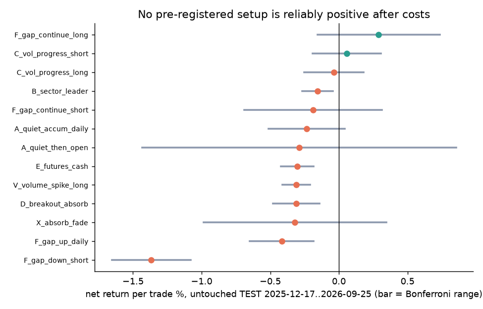
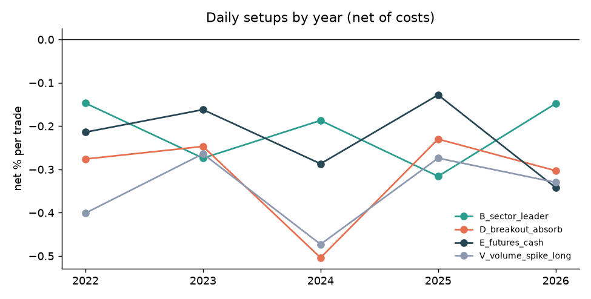

# Round 11 · Phase 9: backtest results

Data: history BEFORE the discovery window only. Daily setups: 461-stock tradable universe, 383,438 stock-days. Opening setups: Nifty 100
(Angel 15-minute bars), 88,884 stock-days. Chronological split: TRAIN 15 Nov 2022 - 7 Mar 2025, VALIDATION 10 Mar - 16 Dec 2025,
TEST (untouched) 17 Dec 2025 - 25 Sep 2026. Net of 0.12 % round-trip costs. Ranges use z = 2.6 (Bonferroni over 13 setups).
Raw: `research/results/r11_backtest.json`; script `research/round11_backtest.py`.

## Untouched TEST period, close exit

| setup | side | trades | per month | win | mean net / trade | range | Rs per trade on Rs 1 lakh | profit factor | worst losing streak | TRAIN | VALIDATION |
|---|---|---|---|---|---|---|---|---|---|---|---|
| B_sector_leader | long | 2,191 | 219 | 43.6 % | -0.16 % | -0.27..-0.04 | -157 | 0.80 | 26 | -0.25 % | -0.25 % |
| D_breakout_absorb | long | 1,758 | 176 | 39.8 % | -0.31 % | -0.48..-0.14 | -311 | 0.72 | 16 | -0.37 % | -0.19 % |
| E_futures_cash | long | 1,398 | 140 | 38.5 % | -0.30 % | -0.42..-0.18 | -304 | 0.63 | 17 | -0.21 % | -0.16 % |
| A_quiet_accum_daily | long | 256 | 26 | 38.7 % | -0.24 % | -0.51..+0.04 | -235 | 0.69 | 11 | -0.25 % | -0.26 % |
| F_gap_up_daily | long | 1,257 | 126 | 40.4 % | -0.42 % | -0.65..-0.19 | -417 | 0.70 | 14 | -1.03 % | +0.16 % |
| F_gap_down_short | short | 936 | 94 | 27.2 % | -1.37 % | -1.66..-1.08 | -1,368 | 0.33 | 40 | -0.91 % | -3.50 % |
| V_volume_spike_long | long | 4,590 | 459 | 39.5 % | -0.31 % | -0.41..-0.21 | -310 | 0.73 | 26 | -0.39 % | -0.23 % |
| C_vol_progress_long | long | 472 | 47 | 47.7 % | -0.04 % | -0.25..+0.18 | -36 | 0.95 | 19 | +0.01 % | -0.10 % |
| C_vol_progress_short | short | 419 | 42 | 52.0 % | +0.06 % | -0.19..+0.31 | +56 | 1.09 | 13 | +0.24 % | -0.18 % |
| F_gap_continue_long | long | 119 | 12 | 61.3 % | +0.29 % | -0.16..+0.74 | +290 | 1.49 | 7 | -0.54 % | +0.01 % |
| F_gap_continue_short | short | 106 | 11 | 45.3 % | -0.19 % | -0.69..+0.31 | -187 | 0.79 | 14 | +0.05 % | -0.48 % |
| A_quiet_then_open | long | 10 | 2 | 30.0 % | -0.29 % | too few | -289 | 0.58 | 6 | +0.35 % (48) | -0.34 % (30) |
| X_absorb_fade | short | 41 | 5 | 51.2 % | -0.32 % | -0.99..+0.35 | -320 | 0.55 | 5 | -0.00 % | +0.28 % |
| baseline: buy every stock at the open | long | 85,017 | - | - | -0.18 % | - | -183 | - | - | -0.24 % | -0.16 % |
| baseline: buy every Nifty 100 stock at 09:30 | long | 18,210 | - | - | -0.11 % | - | -107 | - | - | -0.14 % | -0.14 % |

Target/stop exit (+2 % / -1 %): worse for every daily setup (target reached first on only 12-34 % of trades); TEST means from -0.24 %
to -0.74 %. Opening setups: -0.14 % to +0.10 %.

## By year (close exit, all periods)

Every daily setup was negative in every year 2022-2026. F_gap_continue_long: 2022 -0.82 %, 2023 -0.90 %, 2024 -0.45 %, 2025 +0.12 %,
2026 +0.28 %: positive only recently, on 119 TEST trades, with a range that includes zero.

## By market trend (NIFTY above/below its trend, close exit)

All daily setups negative in both states. C_vol_progress_short: +0.23 % / +0.09 %; F_gap_continue_long: +0.02 % / -0.35 %.

## Verdict per hypothesis

| hypothesis | result |
|---|---|
| A quiet accumulation | rejected: negative in all periods; compression precedes calmer days |
| B sector-leading momentum | rejected: -0.16 % TEST, range excludes zero |
| C opening volume with progress (long) | rejected: zero edge before costs, negative after |
| C bearish mirror | not significant: +0.24 % / -0.18 % / +0.06 %, sign flips between periods |
| D resistance absorption and breakout | rejected: -0.31 % TEST, range excludes zero |
| E futures + cash confirmation | rejected: -0.30 % TEST, range excludes zero |
| F news (gap proxy), buy the open | rejected: -0.42 % TEST |
| F gap-down short | rejected: -1.37 % TEST; gap-downs bounce, especially on market-wide panic days |
| F gap + confirmation (long) | not significant: TRAIN -0.54 %, TEST +0.29 % (range -0.16..+0.74, n 119) |
| V volume spike | rejected: -0.31 % TEST |

No setup passed: positive in TRAIN, VALIDATION and TEST with a TEST range above zero after costs.
