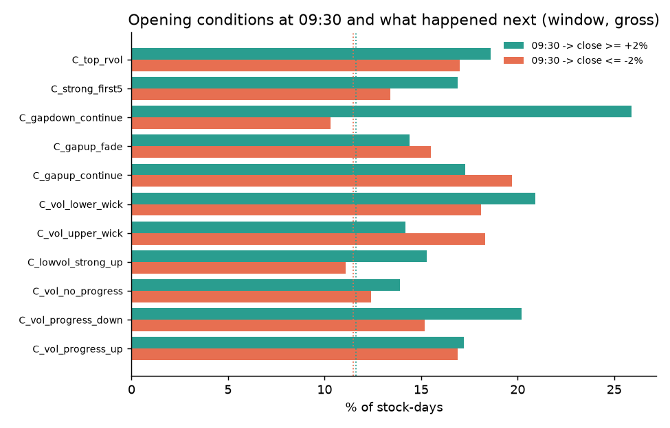

# Round 11 · Phase 3: the opening minutes

## Data actually used

| data | coverage | used for |
|---|---|---|
| Yahoo 5-minute bars | 461 stocks, 13,484 stock-days in the window | 09:15-09:30 features and 09:30-to-close outcomes for every stock |
| Angel One 1-minute bars | the 37 top movers (more downloading); Angel returns about 20 sessions per request, so movers before about 14 Oct are missing (NIACL, CHENNPETRO, IRCON, TRENT, KIRLOSENG) | minute-by-minute timing of the top movers |
| Pre-open (09:00-09:08) order data | NOT available historically | - |
| Angel 15-minute bars | Nifty 100, 5 years | opening setups in the backtest |

Decision time 09:30: features use only bars that ended by 09:30; outcomes start at the 09:30 bar's open. Opening volume is compared with
the same minutes over the previous 20 sessions. Script: `research/round11_open.py`.

## When did the top movers actually move? (1-minute bars)

Two different kinds of big mover; neither is visible in 09:15-09:18 BEFORE the move:

**A. Overnight news, priced at the opening auction.** Half or more of the day's move was already in the 09:15 price.

| stock | gap | 09:15-09:18 | volume in first 3 min (% of day) | 50 % of move done at | close |
|---|---|---|---|---|---|
| TARIL (results) | +9.5 % | +2.3 % | 8.1 % | 09:15 | +15.0 % |
| DIVISLAB | +7.5 % | +3.0 % | 7.7 % | 09:15 | +12.1 % |
| PPLPHARMA (results) | +7.7 % | +2.0 % | 3.8 % | 09:16 | +17.1 % |
| ENGINERSIN (results) | +3.3 % | +5.1 % | 2.7 % | 09:16 | +15.0 % |
| THERMAX | -9.3 % | -3.4 % | 3.0 % | 09:15 | -17.3 % |
| CUMMINSIND | -9.6 % | -0.4 % | 3.7 % | 09:15 | -14.1 % |
| PIIND (results after hours) | -5.9 % | -3.6 % | 2.7 % | 09:18 | -19.1 % |

**B. News during market hours.** The opening was completely ordinary; the move came hours later.

| stock | gap | 09:15-09:18 | first 3 min volume | 50 % of move done at | close |
|---|---|---|---|---|---|
| HBLENGINE | +0.2 % | -0.5 % | 0.2 % | 10:53 | +17.3 % |
| ONESOURCE (results) | +0.4 % | -0.2 % | 0.0 % | 10:15 | +13.8 % |
| ACUTAAS (results) | +0.5 % | +1.0 % | 0.9 % | 12:47 | +13.3 % |
| ATHERENERG (results) | -1.0 % | +0.1 % | 0.6 % | 14:29 | +14.1 % |
| AFFLE | +0.6 % | 0.0 % | 0.1 % | 10:04 | +12.3 % |
| INTELLECT | -0.5 % | 0.0 % | 0.1 % | 13:47 | -16.3 % |
| CARTRADE | -0.3 % | +0.8 % | 0.4 % | 11:48 | -12.6 % |

Across all 358 stock-days that closed up 5 % or more in the window: the median move by 09:30 was +2.25 % of a median +6.09 % day;
only **45 %** had 09:15-09:30 volume of 2x or more, and only **23 %** gapped up 2 % or more. For comparison, 12.3 % of ALL stock-days
had opening volume of 2x or more.

## Opening conditions at 09:30 and what followed (all 13,484 window stock-days, before costs)

| condition at 09:30 | days | 09:30-close >= +2 % | <= -2 % | mean 09:30-close |
|---|---|---|---|---|
| every stock-day | 13,484 | 11.6 % | 11.5 % | +0.02 % |
| volume >= 3x (any direction) | 910 | 18.6 % | 17.0 % | -0.03 % |
| volume >= 2x and price up >= 1 % | 569 | 17.2 % | 16.9 % | -0.02 % |
| volume >= 2x and price down >= 1 % | 441 | 20.2 % | 15.2 % | +0.14 % |
| volume >= 2x, price flat (absorption?) | 194 | 13.9 % | 12.4 % | +0.09 % |
| volume < 1x and price up >= 1 % | 809 | 15.3 % | 11.1 % | +0.15 % |
| volume >= 2x with long upper wick | 197 | 14.2 % | 18.3 % | -0.20 % |
| volume >= 2x with long lower wick | 182 | 20.9 % | 18.1 % | +0.17 % |
| gap >= +2 % and still rising | 173 | 17.3 % | 19.7 % | -0.06 % |
| gap >= +2 % and fading | 187 | 14.4 % | 15.5 % | -0.02 % |
| gap <= -2 % and still falling | 116 | 25.9 % | 10.3 % | +0.56 % (bounce) |
| first 5 minutes up >= 1 %, above VWAP | 732 | 16.9 % | 13.4 % | +0.21 % |

What the opening tells you:
1. **High opening volume predicts a bigger rest-of-day move, in either direction.** Volume of 3x lifts both the +2 % and -2 % odds
   by about 50 %; the average outcome stays at zero. Volume alone is not buying.
2. **Volume plus upward progress did not continue** (-0.02 % on average). By 09:30 the easy part was gone.
3. Upper-wick rejections on heavy volume leaned down (-0.20 %), lower wicks leaned up (+0.17 %); gap-downs still falling at 09:30
   bounced (+0.56 %). These are in-sample observations from one month with wide ranges; they were not pre-registered and are listed as
   candidates for a future test, not as findings.
