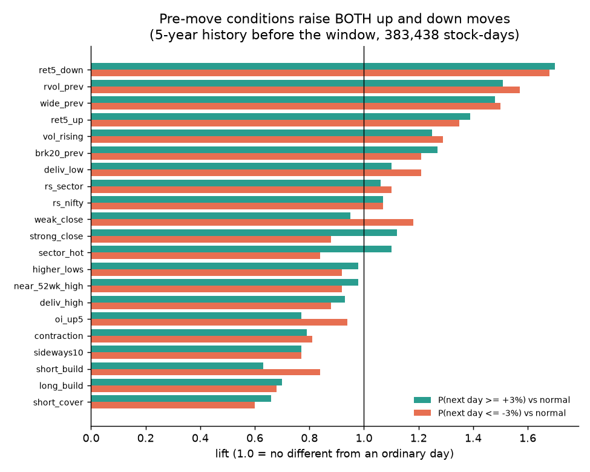

# Round 11 · Phase 2: what happened before the move (10 days, 5 days, previous day)

Every feature is measured at the close of the day BEFORE the move (t-1), so it was known before the move began. Source: Round 8 panel
(price, volume, ATR, delivery %, futures OI and premium, sector and NIFTY relative strength). Script: `research/round11_daily.py`.

## Median pre-move profile

| feature (at t-1) | top 20 gainers | top 20 losers | all +3 % days | all -3 % days | all stock-days |
|---|---|---|---|---|---|
| 5-day return | +0.1 % | -0.8 % | -0.1 % | -1.5 % | -0.8 % |
| 20-day return | -4.4 % | -3.4 % | -4.8 % | -5.0 % | -4.5 % |
| volatility ratio (ATR10/ATR120) | 1.01 | 1.05 | 1.08 | 1.05 | 1.06 |
| 5-day volume vs 20-day | 0.95 | 0.96 | 1.01 | 0.92 | 0.96 |
| previous-day volume vs 20-day | 1.10 | 0.93 | 0.90 | 0.81 | 0.83 |
| delivery % vs 20-day average (points) | +1.7 | -5.3 | 0.0 | -1.1 | -0.7 |
| futures OI change, 5 days | -5.1 % | +9.7 % | -2.3 % | -0.5 % | -1.0 % |
| sector-relative return, 20 days | +0.3 % | -0.3 % | -0.1 % | 0.0 % | 0.0 % |
| previous-day close location (0 = low, 1 = high) | 0.38 | 0.61 | 0.50 | 0.46 | 0.48 |
| previous-day range / ATR | 1.01 | 1.05 | 0.95 | 0.91 | 0.92 |
| opening gap on the day | +0.7 % | -1.4 % | +0.4 % | -0.1 % | 0.0 % |

Reading: before their big day, the top gainers and losers looked almost exactly like every other stock. No sideways compression
(volatility ratio about 1.0), no volume build-up (5-day volume slightly BELOW normal), no delivery surge (+1.7 points is noise), no
leadership against the sector (+0.3 %). The top gainers had, if anything, closed WEAKER the day before (close location 0.38).
The top losers had rising futures OI (+9.7 % over 5 days) and a slightly stronger previous close: the reverse of what a "distribution"
story would predict, and too few cases (20) to mean anything.

## Each condition over 13,501 window stock-days and 383,438 earlier stock-days

Lift = P(move | condition) / P(move on any day). 1.0 means the condition tells you nothing. Bracket = 95 % range.
Base rates: next-day +3 % on 7.8 % of days, -3 % on 5.8 % (history).

| condition at t-1 | up 3 % lift (history) | down 3 % lift (history) | what it predicts |
|---|---|---|---|
| down > 5 % in 5 days | 1.70 | 1.68 | a big move either way |
| previous-day volume > 2x | 1.51 | 1.57 | a big move either way |
| previous-day range > 1.5 ATR | 1.48 | 1.50 | a big move either way |
| up > 5 % in 5 days | 1.39 | 1.35 | a big move either way |
| volume rising (5d/20d > 1.3) | 1.25 | 1.29 | a big move either way |
| new 20-day high at t-1 | 1.27 | 1.21 | a big move either way |
| sector up > 2 % in 5 days | 1.10 | 0.84 | slight upward tilt |
| closed in top 20 % of range | 1.12 | 0.88 | slight upward tilt |
| closed in bottom 20 % of range | 0.95 | 1.18 | slight downward tilt |
| delivery % +10 points above average | 0.93 | 0.88 | slightly CALMER next day |
| long build-up / short covering / short build-up | 0.63-0.70 | 0.60-0.84 | CALMER next day |
| volatility contraction (ATR ratio < 0.8) | 0.79 | 0.81 | calmer, not a coiled spring |
| sideways 10 days | 0.77 | 0.77 | calmer |

Three findings, consistent between the 30-day window and the 5 earlier years:
1. **The strongest pre-move signals predict the SIZE of the next move, not its direction.** Recent volume, wide ranges and big
   recent moves raise the chance of a 3 % day up and down almost equally. This is volatility clustering.
2. **Popular "accumulation" signals do not precede big moves.** High delivery, quiet compression and futures build-up are followed by
   slightly calmer days, not explosions.
3. The only directional tilts are small (sector momentum, strong close: lift 1.10-1.12 up vs 0.84-0.88 down) and Round 7 already found
   them too weak to trade after costs at 1-day holds.

Opening gap lifts (3.4x up, 4.6x down) are excluded from this list: the gap is part of the close-to-close move itself, so it is not a
pre-move signal. Its tradable part (what happens after the open) is in the opening and backtest reports.
