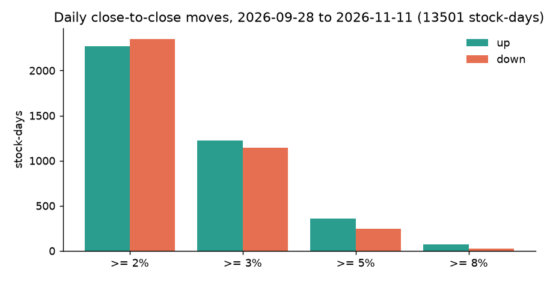

# Round 11 · Phase 1: the top moving stocks (discovery window)

Window: the last 30 completed sessions with full delivery and futures data, **28 Sep to 11 Nov 2026**. Universe: Nifty 500 stocks with
at least 250 sessions of history, a 20-day average traded value of at least Rs 10 crore and a price of at least Rs 50, all known the day
before (461 stocks, 13,501 stock-days). Data: Yahoo daily OHLCV (adjusted), NSE delivery and F&O files. Script: `research/round11_daily.py`.

## How often big moves happen

| move (close to close) | up days | down days |
|---|---|---|
| 2 % or more | 2,269 | 2,350 |
| 3 % or more | 1,227 | 1,141 |
| 5 % or more | 358 | 245 |
| 8 % or more | 74 | 26 |

A 3 % move up or down happens on about **17.5 %** of stock-days: on a typical session about 80 of the 461 stocks move 3 % or more
in one direction or the other. Big moves are common; the hard part is knowing which stock in advance.

Other measures (same window): previous close to day high >= +3 % on 2,429 stock-days, to day low <= -3 % on 2,421; high-to-low
range >= 5 % on 1,947; range >= 4 % with a close within 1 % of the previous close on 440 (big intraday swing, small close).
51 days closed at the day's high after gaining 4.5 % or more (possible circuit locks; kept, flagged).

## Top 20 gainers (each stock's biggest day; cc = close-to-close, oc = open-to-close)

| stock | date | cc | oc | prev close to high | prev close to low | avg value (Rs cr) | sector |
|---|---|---|---|---|---|---|---|
| HEGAM | 04 Nov | +19.8 % | +14.4 % | +20.0 % | +4.7 % | 30 | Capital Goods |
| HBLENGINE | 16 Oct | +17.3 % | +17.1 % | +18.5 % | -1.2 % | 144 | Capital Goods |
| PPLPHARMA | 28 Oct | +17.2 % | +8.7 % | +18.6 % | +5.2 % | 46 | Healthcare |
| NIACL | 12 Oct | +15.3 % | +14.8 % | +19.6 % | +0.2 % | 91 | Financial Services |
| ENGINERSIN | 02 Nov | +15.0 % | +11.4 % | +16.7 % | +3.2 % | 114 | Construction |
| TARIL | 14 Oct | +15.0 % | +5.0 % | +18.7 % | +9.5 % | 142 | Capital Goods |
| CHENNPETRO | 07 Oct | +14.7 % | +14.4 % | +15.9 % | +0.3 % | 302 | Oil & Gas |
| IRCON | 30 Sep | +14.3 % | +13.9 % | +20.0 % | +0.3 % | 19 | Construction |
| ATHERENERG | 26 Oct | +14.1 % | +15.3 % | +17.6 % | -2.5 % | 427 | Auto |
| ONESOURCE | 27 Oct | +13.8 % | +13.3 % | +14.9 % | -0.9 % | 32 | Healthcare |
| ACUTAAS | 27 Oct | +13.3 % | +12.7 % | +16.5 % | +0.4 % | 126 | Healthcare |
| FINCABLES | 09 Nov | +13.0 % | -6.9 % | +21.4 % | +11.7 % | 76 | Capital Goods |
| TRENT | 06 Oct | +12.6 % | +3.8 % | +13.0 % | +7.8 % | 204 | Consumer Services |
| MRPL | 26 Oct | +12.6 % | +13.4 % | +14.0 % | -2.0 % | 244 | Oil & Gas |
| AFFLE | 02 Nov | +12.3 % | +11.6 % | +14.0 % | -0.6 % | 19 | IT |
| SYNGENE | 28 Oct | +12.2 % | +6.4 % | +14.4 % | +2.2 % | 28 | Healthcare |
| KIRLOSENG | 29 Sep | +12.2 % | +12.2 % | +14.1 % | -0.8 % | 96 | Capital Goods |
| DIVISLAB | 09 Nov | +12.1 % | +4.2 % | +14.6 % | +7.3 % | 651 | Healthcare |
| DIXON | 02 Nov | +12.0 % | +11.2 % | +13.6 % | +0.5 % | 328 | Consumer Durables |
| SAILIFE | 06 Nov | +12.0 % | +7.9 % | +13.8 % | +1.3 % | 71 | Healthcare |

Data warning: FINCABLES' 09 Nov row combines the Diwali Muhurat session of 08 Nov (+20 %, absent from the daily data) with a -5 % day.
Special sessions are missing from the daily feed, so a "day" there spans two sessions.

## Top 20 losers

| stock | date | cc | oc | to high | to low | sector |
|---|---|---|---|---|---|---|
| PIIND | 05 Nov | -19.1 % | -14.0 % | -5.0 % | -20.0 % | Chemicals |
| THERMAX | 06 Nov | -17.3 % | -8.8 % | -8.2 % | -19.7 % | Capital Goods |
| SWIGGY | 23 Oct | -16.8 % | -14.1 % | -2.6 % | -17.2 % | Consumer Services |
| INTELLECT | 30 Oct | -16.3 % | -15.9 % | +0.4 % | -17.8 % | IT |
| J&KBANK | 23 Oct | -16.3 % | -16.3 % | +0.6 % | -17.4 % | Financial Services |
| CUMMINSIND | 05 Nov | -14.1 % | -4.9 % | -9.4 % | -14.7 % | Capital Goods |
| TDPOWERSYS | 06 Nov | -13.9 % | -7.0 % | -6.3 % | -16.8 % | Capital Goods |
| APTUS | 05 Nov | -12.8 % | -12.6 % | -0.1 % | -14.0 % | Financial Services |
| CARTRADE | 28 Oct | -12.6 % | -12.4 % | +3.2 % | -18.4 % | Consumer Services |
| KIRLOSENG | 05 Nov | -11.6 % | -10.7 % | -0.7 % | -12.0 % | Capital Goods |
| ECLERX | 29 Oct | -11.0 % | -9.4 % | -1.8 % | -12.7 % | Services |
| HSCL | 21 Oct | -11.0 % | -11.0 % | +0.5 % | -11.9 % | Chemicals |
| URBANCO | 19 Oct | -9.9 % | -4.4 % | -3.6 % | -10.8 % | Consumer Services |
| ASTRAL | 06 Nov | -9.7 % | -8.5 % | -1.3 % | -12.4 % | Capital Goods |
| APARINDS | 06 Nov | -9.7 % | -7.4 % | -1.4 % | -11.7 % | Capital Goods |
| CHENNPETRO | 05 Nov | -9.5 % | -10.8 % | +1.8 % | -10.0 % | Oil & Gas |
| KEC | 03 Nov | -9.4 % | -4.4 % | -3.9 % | -10.9 % | Construction |
| BBOX | 23 Oct | -9.0 % | -8.3 % | -0.5 % | -9.4 % | IT |
| MRPL | 28 Oct | -8.7 % | -7.4 % | +0.7 % | -9.5 % | Oil & Gas |
| JINDALSAW | 21 Oct | -8.5 % | -8.4 % | +0.8 % | -8.9 % | Capital Goods |

## Repeated strong gainers (days with +3 % or more in the window)

BBOX 8 days (window return +8.6 %), AEGISLOG 8 (-10.1 %), CUPID 7 (+31.1 %), RKFORGE 7 (+8.5 %), CARTRADE 7 (-12.3 %), WELSPUNLIV 7
(+13.8 %), MRPL 7 (+8.7 %), IIFL 7 (+8.0 %), HEGAM 7 (+18.4 %), KALYANKJIL 7 (+15.8 %). Several "repeat gainers" ended the window
lower: frequent 3 % up days mark volatile stocks, not trending ones.

## Large intraday swing, small close (|cc| < 1 %)

INFY 23 Oct (range 15.4 %, close 0.0 %), TATATECH 15 Oct (14.1 %, -0.6 %), INDIACEM 22 Oct (13.5 %, +0.6 %), CRAFTSMAN 28 Oct (12.0 %),
KIRLOSENG 06 Nov (10.5 %), BRIGADE 15 Oct (10.1 %). Judged only by closing return, these days look like nothing happened.
Full lists: `research/results/r11_daily.json`.
